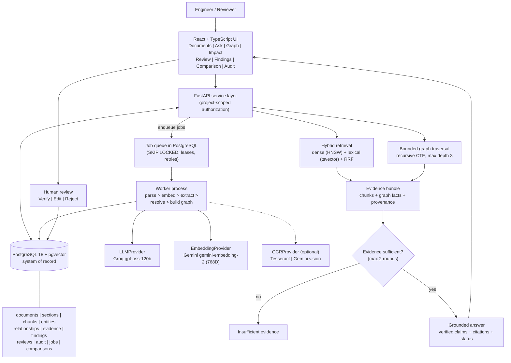
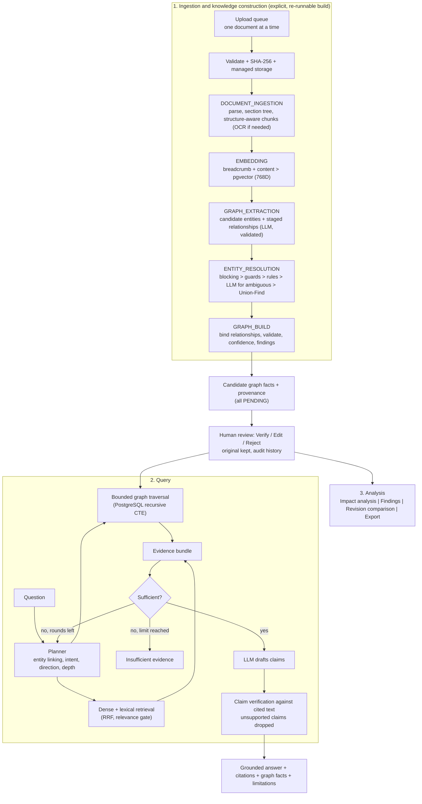

# Submission Diagrams

Mermaid source for the report and synopsis figures. The same diagrams are in `SYSTEM_ARCHITECTURE.mmd` and
`IMPLEMENTATION_WORKFLOW.mmd`; the rendered images are in `figures/`.

## 1. System Architecture (`figures/system_architecture.png`)

## 2. Implementation Workflow (`figures/implementation_workflow.png`)

The figures were rendered from these sources with Mermaid 10.9.1 in headless Chrome.
